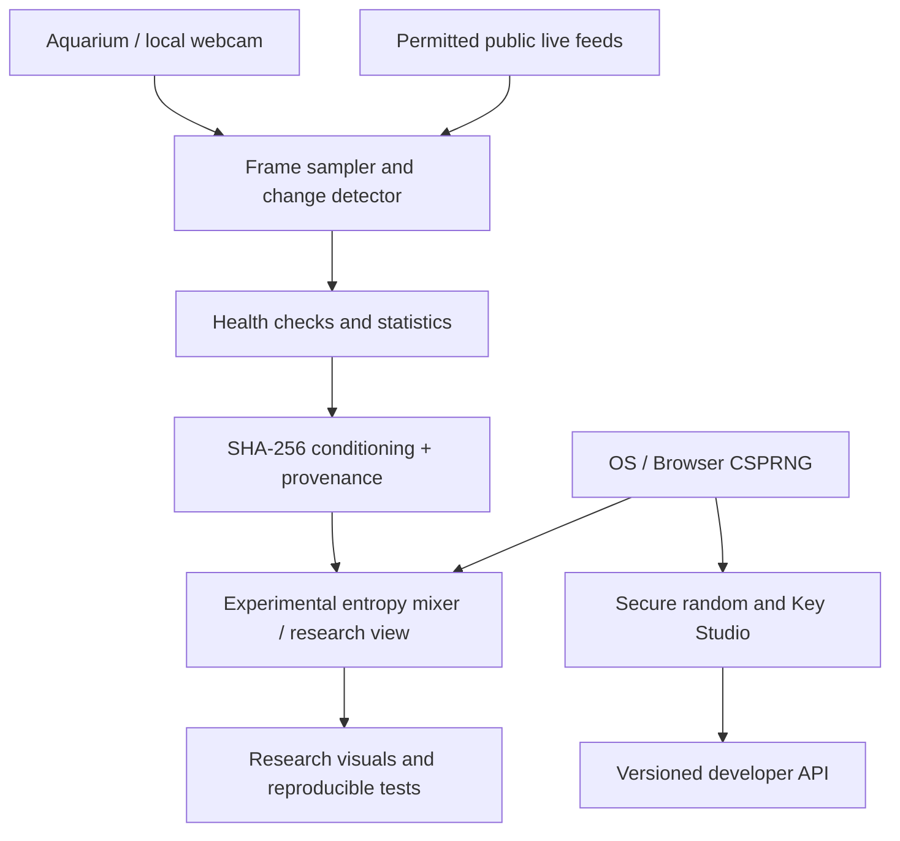

# RandorGenerator — Architecture, Security and Deployment Plan

Status: **design and recovery** (2026-11-25). This document describes intended architecture, not deployed functionality.

## What is already known

Earlier RandorGenerator prototypes existed outside this GitHub repository, including a Node/Express API, camera frame-difference sampling, a SHA-256-based entropy pool, OS randomness, an HMAC-based output path, lottery UI, and experimental entropy diagnostics. The linked GitHub repository was empty when this plan was drafted. **Recover, audit and test the latest original source package before replacing or rebuilding the core.**

## Product areas

1. **Random Lab:** dice, coins, roulette, unbiased ranges, lists and sampling.
2. **Entropy Lab:** webcam/aquarium camera, experimental external live sources, bit-level visualizations, frame differences, quality metrics and JSON exports.
3. **Key Studio:** secure browser-generated random bytes, passwords, API tokens, AES-GCM keys and HMAC keys with user-controlled formats.
4. **Developer API:** versioned endpoints for unbiased random data and source health, with documentation, authentication/rate limits for costly operations and security tests.

## Trust boundary — critical

- The security foundation for secrets is the OS/browser CSPRNG, using `crypto.getRandomValues`, `crypto.subtle.generateKey`, or Node `crypto.randomBytes` as appropriate.
- Images, decoded video frames, frame differences, camera timestamps, fish movements, and remote webcams are **experimental, possibly predictable or attacker-controlled inputs**. They may complement observations but are not assumed to provide validated cryptographic entropy.
- Conditioning with SHA-256/HMAC/HKDF does not create entropy from a predictable input. Do not claim that a camera added N secure bits without proper evidence and assessment.
- Public sources are `auxiliary-untrusted`, never the sole seed for cryptographic keys. Local cameras are `experimental-unvalidated` until assessed.
- The system must remain secure when any camera freezes, disconnects, repeats frames, or returns attacker-selected media.
- Separate deterministic seeded PRNGs (replay, demos and ASCean experiments) from secure randomness (secrets and tokens).
- Never log, cache, transmit to analytics, or expose secret key material unless the user explicitly chooses an export. Favor non-extractable `CryptoKey` objects for real encryption keys.

## Proposed data flow

This separates a **security-guaranteed route** (subject to the platform CSPRNG) from an **experimental route**. A future reviewed design may investigate safely mixing additional inputs into the secure route without introducing dependency on untrusted sources.

## Capture modes

- **Local device:** `getUserMedia` requires explicit browser permission and usually HTTPS. Local camera selection is per device/browser context.
- **Remote aquarium/PC:** a consented local PC collector reads the connected camera and sends *only needed samples/metrics* over an authenticated outbound connection. A phone dashboard can request start/stop through a separate authenticated control channel. Never expose a private aquarium feed publicly by default.
- **External camera:** source catalog with `provider`, `landingPage`, `accessMethod`, `rightsStatus`, `corsStatus`, `health`, `lastSampleAt`. Only ingest feeds when terms/permission and technical read-back permit it. A third-party embedded viewer alone does not authorize canvas pixel extraction.

## Entropy experiment contract

For each sample track: source ID; timestamp; dimensions; frame interval; pixel-change ratio; sample digest; repeated-frame and source-health flags; estimator/test version; explicit `secureEntropyBitsCredited: 0` for unvalidated camera sources. Avoid storing raw camera frames by default. Add frame-freeze, repetitive-pattern and rate checks; compare with synthetic deterministic controls. Report *observed variability*, not inferred cryptographic strength.

## Key Studio controls

- Output kind: password/passphrase, hex/base64 token, random bytes, UUID, WebCrypto AES-GCM or HMAC key.
- Length / bit size / charset (upper/lowercase/digits/symbols), optional minimum category counts, field-based templates and delimiters.
- Character selection must avoid modulo bias (rejection sampling or equivalent); account for reduced search space under strict templates.
- Secrets are generated locally in the browser by default; show once on explicit user action, clearable; avoid URL query strings, logs, clipboard by default, and third-party scripts on secret screens.
- `generateKey({ name: "AES-GCM", length: 256 }, false, ["encrypt","decrypt"])` is the preferred non-exportable encryption-key path. Offer export only in an explicit separate mode.
- Never assert that camera visuals make a key stronger than an already secure CSPRNG key.

## Suggested API (design, not deployed)

- `GET /api/v1/health`
- `GET /api/v1/entropy/sources` (status, never secret state)
- `POST /api/v1/random/integers` with bounds and count, uniform sampling
- `POST /api/v1/random/bytes` with byte count and encoding
- `POST /api/v1/experiments` for non-secret diagnostics (authenticated)
- Keys should usually be created with browser WebCrypto rather than remotely generated or delivered by a public server.

Validate input limits, request volumes and origins. Use rate limiting and authentication on private/expensive endpoints. Ensure no caching of secret responses.

## Deployment strategy

1. **Recover original source** and tests; place in the RandorGenerator repository after audit, preserving history and previous modules where possible.
2. **Static frontend** on GitHub Pages or another HTTPS static host. Keep Random Lab and local Key Studio usable even when backend is offline.
3. **Backend** on a Node-compatible HTTPS host for API and remote collector control. GitHub Pages cannot run Node/Express server code.
4. **Private camera collector** runs only on the trusted Windows PC; outbound authenticated connection with allowlisted operations. No direct camera-port exposure and no raw frames by default.
5. **External source adapters** enabled only once rights and read-back are verified. Keep Times Square as a source research candidate, not a promised integrated feed.
6. **Portfolio card** points to a real tested public URL. Link back to GitHub, show honest `Research / Live Demo` status.
7. **QA gate**: secure-context camera test, source freeze, permission denied, disconnect, mobile viewport, replayable diagnostics, unbiased output tests, API authorization, budgets and privacy.

## Portfolio card copy (English)

**RandorGenerator**
*Exploring randomness — from camera noise and live signals to secure key generation.*

Tags: `Web Crypto` `Entropy Lab` `Node.js` `Camera Signals`

Primary CTA: **Try Live Demo** (only when deployment verified)
Secondary CTA: **View Source**

## Milestones

- M0: Recover original package; inventory modules, defects, and deployment blockers.
- M1: Stabilize secure random/key-generation frontend with no required camera/server dependency.
- M2: Restore aquarium camera analysis + privacy-preserving PC collector and remote mobile controls.
- M3: Experimental camera source catalog with rights/CORS checks and statistical diagnostics.
- M4: Secure and documented developer API with rate limiting and test suite.
- M5: Add portfolio card, verify live HTTPS endpoint, publish release notes and PCM checkpoint.

### References

- MDN MediaDevices.getUserMedia: https://developer.mozilla.org/en-US/docs/Web/API/MediaDevices/getUserMedia
- MDN Crypto.getRandomValues: https://developer.mozilla.org/en-US/docs/Web/API/Crypto/getRandomValues
- MDN SubtleCrypto.generateKey: https://developer.mozilla.org/en-US/docs/Web/API/SubtleCrypto/generateKey
- MDN CORS-enabled canvas: https://developer.mozilla.org/en-US/docs/Web/HTML/How_to/CORS_enabled_image
- NIST SP 800-90B: https://csrc.nist.gov/pubs/sp/800/90/b/final
- NYC DOT data feeds: https://www.nyc.gov/html/dot/html/about/datafeeds.shtml

## Confirmed design decisions — 2026-11-25

### Development workflow

- **Recover first:** user will provide the latest local source package. Inventory and run it before refactoring.
- **Working mechanic first, generic later:** implement a simple end-to-end source path, prove it works, then extract reusable contracts only where needed. Avoid speculative wrappers/functions and premature abstraction.
- **Preserve behavior:** compare existing dashboard, color-coded source health, camera filters, generated JSON, and measurement graphs with the planned target. Classify each existing feature as Keep / Adapt / Remove / Missing.
- Each stage needs evidence: test result, reproducible run command, screenshot or JSON artifact as appropriate, and a decision checkpoint. No silent code rewrites.

### Multi-source model (design)

- A source registry identifies inputs by **stable internal Source ID**, not only OS device identifiers or IP address. Changing hardware must not break saved experiment references.
- Source adapters, introduced incrementally: USB/UVC camera, OS-listed virtual camera, computer-local video file/synthetic fixture, consented network IP camera via a trusted RTSP/HTTP/MJPEG-to-web bridge where appropriate, and permitted public web feeds.
- Browser device selectors use supported `enumerateDevices`/`getUserMedia` with permission; those select **devices connected to the browsing device**, not cameras connected to another PC.
- A Windows camera collector connects to the remote backend through an authenticated outbound channel. Phone dashboard sees approved preview/metrics and controls the collector with access checks. For initial LAN testing, use a private authenticated path; never require opening a public port to the camera.
- The interface can activate one or multiple sources independently, rename them, switch sources, select sampling frequency and sampling region, assign optional experimental weights, and compare **per-source vs combined** observations.
- Multi-source fusion must detect correlated / identical inputs and source freeze/failure. A second camera is not automatically an independent entropy source; raw concatenation and XOR alone are not evidence of added secure entropy.
- Default to metadata/digests and low-rate thumbnails only when approved; never publish raw personal camera streams or IP-camera credentials.

### Measurement/reporting contract

Use precise, separately labeled metrics instead of one misleading "randomness percentage":

| Metric | Meaning | Percentage allowed? |
|---|---|---|
| Ones fraction | Number of 1 bits divided by all measured bits | Yes; 50% is expected for balanced bits, not 50% quality |
| Pixel change ratio | Fraction of pixels that changed per sampled interval | Yes; motion is not entropy |
| Source uptime / frozen frame ratio | Source health and repeated frames | Yes |
| Statistical test pass count | Fraction of defined tests passing, for declared sample size and conditions | Yes, but not a security percentage |
| Byte distribution, runs, autocorrelation, cross-source correlation | Evidence about distributions and relationships | Show raw statistics, graphs and confidence intervals |
| Estimated min-entropy | Model-dependent conservative source estimate | Bits per sample, and uncertainty, never "percent secure" |

Comparisons use the *same* sample lengths and processing rules for (A) OS CSPRNG baseline, (B) each camera alone, (C) selected combined experimental pool, (D) known synthetic/deterministic negative controls, and optionally (E) independently obtained physical sources. Record input sample lengths, dropped frames, filters, extraction, source versions and test versions.

- NIST SP 800-22 is a statistical test suite; passing is **not** proof of unpredictability or cryptographic suitability.
- NIST SP 800-90B entropy-source modeling, health testing, and conservative entropy estimation are a separate, higher bar. Unvalidated video streams receive no credited secure-entropy bits.
- Each experiment exports stable versioned JSON with inputs/provenance, sample configuration, output digests where safe, metrics, confidence interval or uncertainty, and reference controls. **No secret cryptographic keys in experiment files.**
- Traffic-light indicators must label what they grade (source health or test status), never ambiguous "secure" scores.

### Crypto experiment separation

- **Production/security lane:** use existing reviewed cryptographic primitives and platform CSPRNG. Keys and nonces/IVs follow each algorithm's requirements; e.g., authenticated encryption requires nonce uniqueness, and an IV is generally not secret. Never build an ad-hoc combined Key+IV primitive for real users.
- **Research lane:** explore bitfields, structured keys, derived subkeys and camera-conditioned variants, with a documented threat model, attacker control assumptions, replayable fixtures and explicit `EXPERIMENTAL / NOT FOR PRODUCTION` labels.
- Additional inputs must not replace or reduce the security of CSPRNG output. More layers, more cameras, or better statistical indicators are **not** a cryptographic security guarantee.

### Project observability and governance

After source recovery, adapt to existing repo conventions (do not create duplicate systems):

- `RULES.md` — scope, style, no redundant functions, contracts, testing, security/privacy, architectural boundaries.
- `TIMELOG.md` — actual work sessions and checkpoints.
- `CHANGELOG.md` — functionality changes and release/rollback notes.
- `DECISIONS.md` — decisions and rejected alternatives with reasons.
- `docs/ARCHITECTURE_ATLAS.md` / optional interactive Atlas — source graph, trust boundaries, source adapters, flow and module statuses.
- `docs/EXPERIMENTS.md` plus versioned fixtures/results — methods, baselines and reproducibility.
- `logs/` only for appropriately redacted runtime diagnostics; no private video, camera credentials, tokens or keys. Authentication/access events, if needed, remain access-controlled and retention-limited.
- PCM checkpoint maps source commit -> tests -> experiment schema -> approved decision -> deploy/rollback reference.

### Immediate next checkpoint (user source upload)

On receipt of the files: identify actual entrypoints, dependencies, camera code, filters, JSON schema, metrics/dashboards, and execution commands; run the original MVP and classify gaps. **First user-visible target:** from a phone, securely view a preview or metrics from a camera connected to the Windows PC. Do not introduce more source types until this is reproducible.
